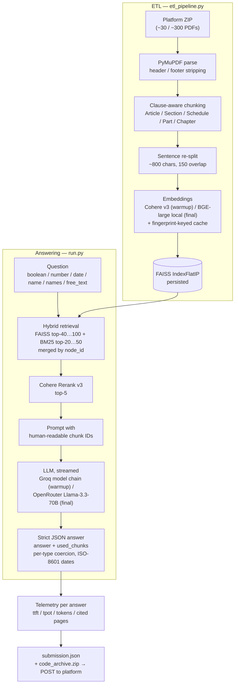

# Legal Agentic RAG — Hybrid Retrieval & Grounded LLM Answers


End-to-end **Retrieval-Augmented Generation pipeline for English-language legal
corpora** (DIFC laws and court cases): clause-aware PDF chunking, hybrid
FAISS + BM25 retrieval, Cohere reranking, and strictly-grounded JSON answers
with per-question latency telemetry.

Two real, platform-verified submissions to the **Agentic RAG Legal Challenge
2026** at *Machines Can See 2026* — kept side by side as an honest engineering
log of the trade-offs between hosted and local model stacks.

| | Highlight |
|---|---|
| 🏆 | Best **warm-up score 0.591**, with **0.886 deterministic accuracy** on typed legal questions (boolean / number / date / name / free_text) |
| 🔎 | Hybrid retrieval (semantic FAISS + lexical BM25) with Cohere Rerank v3 and citation-filtered grounding |
| ⚡ | Streaming generation with **TTFT ≈ ceiling (Time 1.000)** and faithfulness **0.998–1.016** on both submissions |
| 🔁 | Cost-aware engineering: embedding cache keyed by corpus fingerprint, resume-safe long runs, TPD-aware LLM fallback chain |
| 📦 | ~3.4k lines of Python, each solution fully runnable end-to-end, no secrets and no competition data committed |

---

## Results

Both submissions were graded on the official platform leaderboard under the
same scoring formula; numbers are taken directly from it
(full table and analysis in [`docs/RESULTS.md`](docs/RESULTS.md)):

| Submission                 | Phase      | Det   | Asst  | Grounding | Time  | Faith. | **Total** |
|----------------------------|------------|-------|-------|-----------|-------|--------|-----------|
| [`solutions/warmup`](solutions/warmup) | warm-up (100 q) | 0.886 | 0.613 | 0.728 | 0.994 | 1.016  | **0.591** |
| [`solutions/final`](solutions/final)   | final (900 q, private) | 0.606 | 0.585 | 0.546 | 1.000 | 0.998  | **0.327** |

*Det* = deterministic accuracy, *Asst* = free-text quality (LLM-judge),
*Grounding* = page-level retrieval grounding, *Time* = TTFT modifier,
*Faith.* = no-hallucination check. The final phase runs over a 3× larger
corpus and 9× more questions, where single retrieval misses become binary —
the drop is analysed openly in [`docs/RESULTS.md`](docs/RESULTS.md), together
with the known sub-optimal spots of the submitted state.

---

## Architecture



In one pass the system:

1. **Ingests** PDFs with PyMuPDF, strips repeated headers/footers, segments
   text at *Article / Section / Schedule / Part / Chapter / numbered clause*
   boundaries (clause-aware chunking), and further splits long segments by
   sentences (~800 chars, 150 overlap).
2. **Indexes** chunks into a FAISS `IndexFlatIP` store, with an embedding
   cache keyed by a SHA-256 corpus fingerprint — a re-run never re-embeds an
   unchanged corpus.
3. **Answers** each question with a hybrid retriever (semantic FAISS + lexical
   BM25), reranks candidates with Cohere Rerank v3, streams the answer from an
   LLM, and parses a strict JSON response (`answer` + `used_chunks`).
4. **Reports telemetry** for every answer: `ttft_ms`, `tpot_ms`,
   `total_time_ms`, token usage, and grounding pages filtered down to the
   chunks the model actually cited.

The submission schema and the evaluation-platform contract are documented in
[`docs/platform/`](docs/platform).

---

## Stack comparison

| Component       | warmup                                          | final                                              |
|-----------------|----------------------------------------------------|-------------------------------------------------------|
| Embeddings      | Cohere `embed-english-v3.0` (API, 1024-d)          | `BAAI/bge-large-en-v1.5` (local HuggingFace, 1024-d)  |
| Vector index    | FAISS `IndexFlatIP`                                | FAISS `IndexFlatIP`                                   |
| Lexical search  | BM25 (top-20)                                      | BM25 (top-50)                                         |
| Semantic top-K  | 40                                                 | 100                                                   |
| Reranker        | Cohere Rerank v3 (top-5)                           | Cohere Rerank v3 (top-5)                              |
| LLM             | Groq multi-model chain (Llama-4-Scout → 3.3-70B → gpt-oss-20b → 3.1-8b), TPD-aware fallback | OpenRouter `meta-llama/llama-3.3-70b-instruct`        |
| Resume support  | no                                                 | yes (re-uses prior `submission.json`)                 |
| Chunk metadata header in embedding | yes (title + case numbers)         | no                                                    |

The differences are **only** in `run.py` and `etl_pipeline.py`; the API
client (`arlc/`), retry/rate-limit helpers (`api_utils.py`), and the
submission/telemetry schema are shared.

---

## Repository layout

```
legal-rag-challenge-2026/
├── README.md                  # this file
├── LICENSE                    # MIT
├── .env.example               # template — no secrets
├── docs/
│   ├── COMPETITION.md         # participant guide (organizer-provided)
│   ├── RESULTS.md             # full leaderboard table + analysis
│   └── platform/              # platform spec
│       ├── API.md
│       ├── EVALUATION.md
│       └── openapi.yaml
└── solutions/
    ├── warmup/                # self-contained submission #1 (v7_warmup)
    │   ├── README.md
    │   ├── ARCHITECTURE.md
    │   ├── requirements.txt
    │   ├── run.py
    │   ├── etl_pipeline.py
    │   ├── api_utils.py
    │   └── arlc/
    └── final/                 # self-contained submission #2 (v2_final)
        ├── README.md
        ├── ARCHITECTURE.md
        ├── requirements.txt
        ├── run.py
        ├── etl_pipeline.py
        ├── api_utils.py
        └── arlc/
```

Each `solutions/<name>/` directory is **fully runnable on its own** — there is
no shared code outside the directory. This keeps each submission exactly as it
was packaged for the platform and lets you reproduce either one in isolation.

---

## Quick start

Pick a solution, install its requirements, set the relevant API keys in `.env`,
and run it from inside the solution folder.

```bash
# Pick one:
cd solutions/final     # or: cd solutions/warmup

python -m venv .venv
# Windows PowerShell
.venv\Scripts\Activate.ps1
# macOS / Linux
# source .venv/bin/activate

pip install -r requirements.txt

cp ../../.env.example .env   # then fill in the keys you actually use

python run.py
```

`run.py` will:

1. download questions and the document ZIP from the platform,
2. build (or load a cached) FAISS index,
3. answer every question with telemetry,
4. write `submission.json`, build `code_archive.zip`, and POST both to the
   platform.

Per-solution details (required keys, hardware notes for local BGE embeddings):

- [`solutions/warmup/README.md`](solutions/warmup/README.md)
- [`solutions/final/README.md`](solutions/final/README.md)

---

## Why two versions

The warm-up corpus (~30 documents, 100 questions) and the final corpus
(~300 documents, 900 questions) were graded under the same scoring formula,
but the *relative* importance of the components changes with corpus size and
question distribution:

- **warmup** leans on hosted Cohere embeddings + a Groq model chain. On the
  small warm-up set this produced the highest deterministic accuracy (0.886)
  and the best grounding (0.728).
- **final** switches to local BGE embeddings and a single strong LLM via
  OpenRouter. Latency and faithfulness reach near-perfect scores
  (1.000 / 0.998), but deterministic accuracy and grounding regress on the
  full 900-question set.

Keeping both versions side by side makes the trade-off legible: it is an
honest engineering log, not a single tuned number.

---

## Author

**Maria Zykova** — [github.com/MiaZym](https://github.com/MiaZym)

---

## Disclaimer

- This is a personal portfolio project. The evaluation platform, document
  corpus, and challenge spec belong to the *Machines Can See 2026 /
  Agentic RAG Legal Challenge* organizers; `docs/COMPETITION.md` and
  `docs/platform/` are organizer-provided materials.
- No competition data (PDFs, questions, submissions, embedding caches, logs)
  is included in this repository — see `.gitignore`.
- API keys are **not** committed. Use `.env.example` as a template and supply
  your own credentials.
